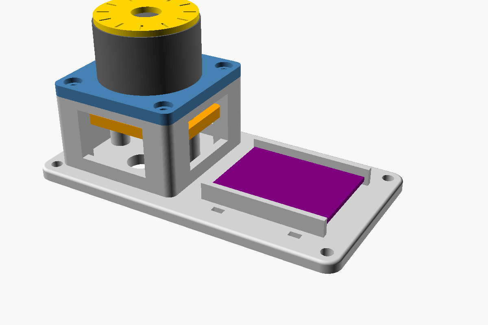

# FOC 테스트 거치대 — 2804 짐벌모터 + AS5600 + B-G431B-ESC1

모터 하나를 ESC1 보드 한 장으로 FOC 제어하는 실험용 거치대. 모터는 타워 위
모터판에 올라가고, AS5600 은 타워 안에서 모터 바닥의 자석을 올려다보며,
ESC1 은 옆 트레이에 케이블타이로 묶는다.



| | |
|---|---|
| 설계 | CadQuery 파라메트릭 — [`foc_test_stand.py`](foc_test_stand.py) 가 정본 |
| 출력 | Bambu Lab A1 mini, PLA ([`print/`](print/) 의 3MF) |
| 상태 | v4 출력·조립 완료 (2026-10). 끼워맞춤 공차 확인은 남음 |

## 파일

| 경로 | 내용 |
|---|---|
| `foc_test_stand.py` | 모델 원본. **치수는 전부 파일 상단 파라미터로만 바꾼다** |
| `print/foc_test_stand_A1mini_v4.3mf` | 부품 전체를 180×180 베드에 배치 — Bambu Studio 에서 바로 슬라이스 |
| `print/…_v4_자석플러그.3mf` | 4 mm 자석 플러그 3종만 |
| `print/…_v4_표시판.3mf` | 슬롯형 표시판만 |
| `img/` | 조립 렌더, 단면도 |
| `out/` | 스크립트 실행 시 생성되는 부품별 STEP·STL — **git 에 올리지 않는다** (재생성 가능) |

이전 버전(v1~v3 3MF, OpenSCAD 판, CadQuery zip)은 커밋 `d6fdc60` 에 남아 있다.
OpenSCAD 판은 ESC1 치수가 틀린 구버전이라 쓰지 않는다.

## 부품

| 부품 | 설명 |
|---|---|
| `base` | 바닥판 112×58 mm + 타워(46 mm 사각, 높이 26 mm) + 캐리어 기둥 2개 + ESC 트레이(안쪽 43×32) + 작업창·케이블창·케이블타이 슬롯·책상 고정 구멍 |
| `motor_plate` | 방사형 슬롯 4개(M2.5, 폭 2.8)로 홀 피치 12~25 mm 대응, 중앙 12 mm 구멍, 모서리 M2.5 4개로 타워 체결, 아랫면에 AS5600 나사머리 자리 |
| `sensor_carrier` | AS5600 포켓 23.6 mm, 헤더 통과 슬롯 2개(11×4.4), 대각 M2.5 2개로 보드 고정 |
| `spacers` | 0.4 / 0.6 / 1.0 mm 각 2개(바깥 6, 안 2.9). 기둥에 끼워 센서를 올린다 — **칩↔자석 간격 조정용** |
| `magnet_plug_m4_*`, `m6_*` | 중공축(실측 내경 4.7, 축과 함께 회전) 아래에 압입하는 자석 홀더. 축 내경 3종 4.5/4.7/4.9(노치 1·2·3개로 구분). m4 = AS5600 동봉 자석 4×1.9, m6 = 6×2.5 용. 머리 높이 3.7 mm 로 같아서 호환. 자석은 머리 바닥 홈에 순간접착 |
| `indicator` | 회전자 윗면에 M2 로 고정하는 30° 눈금 표시판(두께 3). 대각선 십자 슬롯(배치 원 8~17 mm)으로 구멍 편차 흡수 |

## 핵심 파라미터 (`foc_test_stand.py` 상단)

| 이름 | 값 | 의미 |
|---|---|---|
| `SENSOR_W` / `SENSOR_L` | 22.7 / 23.1 mm | AS5600 보드 실측 (판매 페이지보다 큼) |
| `SENSOR_HOLE_PITCH` | 16.0 mm | 보드 구멍 중심 간격 (실측) |
| `MOTOR_D` | 34.4 mm | 모터 외경 (실측) |
| `HEADER_ROW_Y` | 6.5 mm | 보드 중심 ~ 헤더 줄 거리 |
| `ESC_L` / `ESC_W` | 41 / 30 mm | ESC1 크기 (ST 공식) |
| `SHAFT_IDS` | 4.5, 4.7, 4.9 mm | 자석 플러그 축 내경 후보 (실측 4.7) |
| `SLOT_R_MIN/MAX`, `SLOT_W` | 6 / 12.5, 2.8 mm | 모터 고정 슬롯 범위 (실측 홀 원 지름 약 19.8) |
| `TOWER_H`, `MAG_GAP` | 26, 2.5 mm | 타워 높이, 스페이서 없을 때 칩~자석 간격 |
| `MAGNET_FIT` | 0.6 + 모따기 0.4 | 자석 홈 여유. 0.2 로는 작게 나와(4.2→3.7) 키웠다 |

### 높이 관계 — 엔코더 간격이 여기서 정해진다

모터 바닥이 평평하므로(축 돌출 0) 자석 아랫면은 모터판 윗면보다 3.7 mm 아래
(플러그 머리 높이 고정). 기둥 높이는 스페이서 없이 칩~자석 **2.0 mm** 가 되게
계산돼 있고, 스페이서로 줄인다.

- 6 mm 볼트 제약 때문에 스페이서는 기둥당 최대 1.6 mm → **간격 최소 약 0.4~0.9 mm**
- 4 mm 동봉 자석은 약해서 **1.0 mm 스페이서(간격 1.0 mm)부터** 시작

**간격은 펌웨어로 맞춘다.** AS5600 의 AGC 레지스터가 거리 게이지다 —
스페이서를 바꿔가며 **MD=1, AGC 60~90** 에 들어오게. AGC 가 128(최대)에 붙어
있으면 아직 멀다. 진단 펌웨어와 원리는
[엔코더 노트](../../notes/2026-08-29-magnetic-encoder-as5600.md) 참고.

### 나사와 너트

보유 볼트는 **플라스틱** M2 / M2.5, 전부 6 mm — 금속 볼트는 엔코더 자기장에
영향을 줄 수 있어서 플라스틱을 골랐다. 플라스틱 볼트는 PLA 에 셀프태핑이 안 되므로
M2.5 플라스틱 너트(실측 폭 4.8, 두께 2.0)를 쓴다. 너트 홈은 폭 5.1, 두께 2.3,
위쪽 벽 0.8. 타워 모서리 4곳, 기둥 2곳, 캐리어 밑면 2곳.

모터 바닥 구멍은 깊이 4 mm 이상 확인됨. 모터판 나사 자리가 2.5 mm 라 볼트는 모터에
3.5 mm 만 들어간다 — **너무 긴 볼트는 권선을 뚫어 단락시킨다.**

## 출력 설정

A1 mini + PLA, 레이어 0.2 mm, 벽 3겹, 채움 20~25 %, **서포트 없음**
(모든 부품이 서포트 없이 나오는 방향으로 배치돼 있다).
슬라이스는 Bambu Studio 에서 직접 한다 — G-code 는 만들어 두지 않는다
(기기 프로파일 재현이 불확실하다).

## 조립 순서

1. 자석 플러그 3종 중 중공축에 **꽉 끼는 것**을 고른다 → 자석을 머리 홈에 순간접착
2. 플러그를 모터 바닥 중공축에 압입
3. 모터를 모터판 슬롯에 M2.5 로 고정 → 모터판을 타워에 체결
4. AS5600 을 캐리어 포켓에 넣고 고정 (**칩 면이 위 = 자석 쪽**, 헤더는 칩 반대면)
5. 기둥에 스페이서를 끼우고 캐리어 체결 — 4 mm 자석은 1.0 mm 부터
6. ESC1 을 트레이에 케이블타이로 고정

⚠️ **자석 중심이 칩 중심에서 어긋나면 각도가 비선형으로 읽힌다.** 캐리어를
조이기 전에 정렬을 확인할 것. 처음엔 **모터 전원 없이 각도 읽기부터** 확인한다.

## 설계 규칙

1. 구조·치수 변경은 CadQuery 코드에서 끝낸다. 숫자는 상단 파라미터로만 관리
2. FreeCAD 수정은 코드로 되돌아가지 않는 단방향 작업이다 — 중요한 변경은 코드에도 반영
3. 부품을 바꾸면 STEP + STL + A1 mini 배치 3MF 를 같이 만든다
4. 실측값이 생기면 파라미터에 반영하고 이 README 의 표도 고친다

도구: CadQuery 2.8 (Python 3.12 venv) + VS Code OCP CAD Viewer(`show(asm)`) +
FreeCAD(마무리) + Bambu Studio(슬라이스).

```powershell
# 재생성: out/ 에 부품별 STEP·STL 과 assembly.step 이 생긴다
python foc_test_stand.py
```

## 남은 확인 항목

- [ ] 출력물 끼워맞춤(포켓, 플러그 압입, 슬롯) → 필요하면 공차 `TOL` 조정
- [x] 스페이서 조합 실측 (2026-10-10, AS5600 동봉 4×1.9 자석, 3.3V 모드):
      스페이서 없음 → MD=1, **AGC=128** (최대, 여유 없음) /
      **1.0 mm → MD=1, AGC=21** (신호 강함, 채택). 정중앙(~60)을 원하면 0.6 mm 가
      후보 — 단 PWM 간섭 내성은 신호가 강할수록 좋아서 1.0 mm 를 쓴다

## 이 거치대로 할 수 있는 다음 프로젝트 (ESC1 1장 = 모터 1개 기준)

| 후보 | 적합도 | 메모 |
|---|---|---|
| 햅틱 노브 (SmartKnob 류) | 가장 좋음 | 저속·토크 제어라 ESC1·AS5600 약점이 적다 |
| 리액션 휠 / 자평형 뢸로 삼각형 | 가능 | MPU6050(0x68)과 AS5600(0x36)을 같은 I2C 버스에 연결 가능 |
| 3D 프린트 감속기 액추에이터 | 가능 | 공개 사례는 5008급 모터라 2804 에 맞게 축소 필요 |
| 2륜 밸런싱 로봇 | 어려움 | 모터 2개 → ESC1 2장 + 보드 간 통신 |

참고: [ReuleauxTriangle](https://github.com/SmallPond/ReuleauxTriangle) ·
[MBt2](https://github.com/rrmudry/MBt2) · SimpleFOC 포럼 "B-G431B-ESC1: Beginner guide + I2C guide"

---
관련: [핀맵](../../projects/p0-setup/docs/pinmap.md) ·
[p1-foc-bringup](../../projects/p1-foc-bringup/) ·
[엔코더 브링업 로그](../../log/2026-08-29-encoder-bringup.md)
